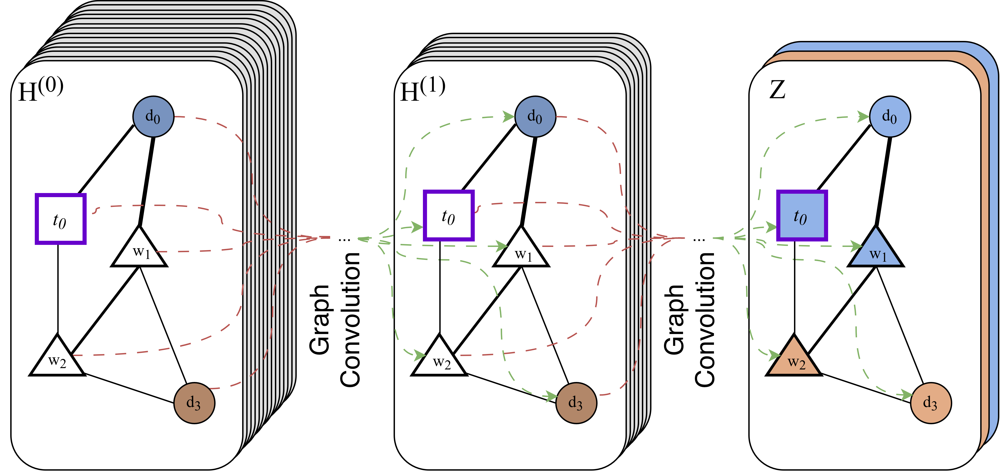

<!--
SPDX-FileCopyrightText: Copyright © 2026 Idiap Research Institute <contact@idiap.ch>

SPDX-License-Identifier: Apache-2.0
-->

# Topic-GCN: Modelling Thematic Structure in Clinical Dialogues for Interpretable Depression Detection

> **Quick Links:** [The idea](#-the-idea-topics-as-nodes-of-the-graph) · [Installation](#-installation) · [Reproducing the paper](#%EF%B8%8F-reproducing-the-paper) · [Expected results](#-expected-results) · [Data preparation](data_prep/README.md) · [Differences from the paper](#-differences-from-the-paper) · [Citation](#-citation) · [Contact](#%EF%B8%8F-contact)

This repo contains the code to reproduce our [TSD 2026 paper](https://doi.org/10.1007/978-3-032-37249-9_47).

## 💡 The idea: topics as nodes of the graph

Text GCNs classify documents by propagating information over a graph of words and documents, connected by word co-occurrence (PMI) and TF-IDF.
They capture lexical associations well, but a clinical interview is more than a bag of related words.
It moves through themes such as family, sleep, work or past events, and the same theme can be phrased with very different words.

**Topic-GCN** makes that thematic structure explicit by adding the topics of a topic model as nodes of the graph, next to the word and document nodes:

<p align="center">
  
</p>

| Edge | Weight |
|------|--------|
| word ─ word | PMI of the two words (positive values only) |
| word self-loop | PageRank of the word |
| word ─ document | TF-IDF |
| word ─ topic *(new)* | P(w \| t) |
| topic ─ document *(new)* | P(t \| d) |

- **Nodes.** The words (the 250 most discriminative by ANOVA F-value), the training interviews and the topics of a topic model trained beforehand (LSA, LDA or BERTopic).
- **Features.** FastText embeddings instead of one-hot vectors. A word is its embedding, a document the average embedding of its words, and a topic the average embedding of its top words.
- **Model.** A two-layer GCN trained on the training interviews. Its inference is *inductive*, as in [InducT-GCN](https://arxiv.org/abs/2206.00265): an unseen interview is attached to the learned word and topic nodes, and is classified without retraining.

Because label information also propagates to the topic nodes, every topic ends up associated with a class.
`run_topic_gcn.py` saves the class probabilities of every word and topic node, so the model's decisions can be read through its topics.

## 🚀 Installation

```bash
conda env create -f environment.yml
conda activate topic-gcn
python -m nltk.downloader stopwords punkt punkt_tab
```

or, with an existing Python 3.12 environment, `pip install -r requirements.txt`.
The versions in [`requirements.txt`](requirements.txt) are those of the environment the paper's experiments ran in.

## ▶️ Reproducing the paper

```bash
# 1. build the interview files from your copy of DAIC-WOZ and E-DAIC (see data_prep/README.md)
python data_prep/prepare_data.py --corpus daic-woz --root /path/to/DAIC-WOZ --out data/daic-woz
python data_prep/prepare_data.py --corpus e-daic   --root /path/to/E-DAIC   --out data/e-daic

# 2. Table 1: train the FastText embeddings and the topic models, and report their coherence
bash scripts/table1/run_all.sh

# 3. Table 2: train and evaluate GCN and Topic-GCN, and print the table
bash scripts/table2/run_all.sh
```

| Result | What it runs | Script |
|--------|--------------|--------|
| Table 1 | FastText, LSA, LDA and BERTopic on the training interviews; C<sub>v</sub> coherence | [`scripts/table1/run_all.sh`](scripts/table1/run_all.sh) |
| Table 2 | GCN and the four Topic-GCN variants, on both corpora | [`scripts/table2/run_all.sh`](scripts/table2/run_all.sh) |

Every script takes its settings from environment variables listed at its top, e.g. `DATASETS=daic-woz SYSTEMS=topic-gcn-bertopic bash scripts/table2/run_all.sh`.

> [!NOTE]
> The DAIC-WOZ and E-DAIC licences do not allow us to redistribute the corpora or anything derived from them, so this repository includes neither the data nor the models we trained on it (FastText embeddings and topic models).
> You need your own copy of the corpora, and you train the models with the scripts below.
> Because some of these models cannot be retrained bit-for-bit, **your Table 2 scores may differ from the ones reported** (see [Differences from the paper](#-differences-from-the-paper)).

### 📦 Models

[`scripts/table1/run_all.sh`](scripts/table1/run_all.sh) trains every model the experiments need:

```bash
python train_fasttext.py    --dataset daic-woz                    # models/daic-woz/fasttext/
python train_topic_model.py --dataset daic-woz --model lsa        # models/daic-woz/lsa/       (k=7)
python train_topic_model.py --dataset daic-woz --model lda        # models/daic-woz/lda/       (k=13)
python train_topic_model.py --dataset daic-woz --model bertopic   # models/daic-woz/bertopic/
python train_topic_model.py --dataset daic-woz --model lda --sweep   # C_v for k in 2-20, 30, 40 (Table 1)
```

LDA retrains identically; the other models come out close but not identical (see [below](#-differences-from-the-paper)).

### 🧪 Running one system

[`run_topic_gcn.py`](run_topic_gcn.py) trains and evaluates one system on one corpus:

```bash
python run_topic_gcn.py --dataset daic-woz --system topic-gcn-bertopic
```

| `--system` | Paper row | Init. (V<sub>w</sub>, V<sub>d</sub>, V<sub>t</sub>) | Topic model |
|------------|-----------|---------------|-------------|
| `gcn` | GCN | (ohe, tf-idf, -) | - |
| `topic-gcn-ft` | Topic-GCN | (ft, ft, -) | - |
| `topic-gcn-lsa` | Topic-GCN | (ft, ft, ft) | LSA |
| `topic-gcn-lda` | Topic-GCN | (ft, ft, ft) | LDA |
| `topic-gcn-bertopic` | Topic-GCN | (ft, ft, ft) | BERTopic |

By default it uses the learning rate and number of training steps of the Table 2 runs, listed in [`conf/hparams.yaml`](conf/hparams.yaml).
`--hpo` searches them again with 100 Optuna trials, `--lr` and `--steps` set them by hand.

It writes two files to `exp/<dataset>/<system>/<eval-split>/`:
- `results.json`: scores and hyperparameters;
- `node_predictions.json`: class probabilities of every word, training document and topic node.

### 🔧 Settings

All runs share these settings:

| Setting | Value |
|---------|-------|
| Word nodes | top-250 words by ANOVA F-value with the labels (English stop words removed) |
| PMI window | 3 words, positive PMI only |
| Hidden layer | 64 units, ReLU, dropout 0.5 |
| Optimiser | AdamW, full batch, class-weighted cross-entropy |
| Model selection | macro F1 on the evaluation split after every step; the best step is kept |
| Hyperparameter search | 100 Optuna (TPE) trials; learning rate in [1e-7, 1e-3], steps in [50, 13000], both log-uniform |
| FastText | 200 dimensions, window 5, min count 2, 30 epochs, trained on the training interviews |
| LSA / LDA | trained on 300-token chunks of the training interviews; k chosen by C<sub>v</sub> coherence |
| BERTopic | `all-MiniLM-L6-v2`, UMAP(n_neighbors=2, n_components=3, min_dist=0.05), HDBSCAN(min_cluster_size=10, min_samples=10), bigram `CountVectorizer`; 300-word chunks |

> [!IMPORTANT]
> As stated in the paper, the hyperparameters and the best training step were selected on the split that is reported, i.e. the **test** split (`--eval-split test`, the default).
> The scores of Table 2 therefore reflect optimised benchmark performance rather than unbiased estimates.
> Use `--eval-split dev --hpo` to select everything on the development split instead.

## 📊 Expected results

### Table 2

Macro F1 (Avg.) and F1 of the depressed (D) and control (C) classes on the test splits, obtained with this code on an NVIDIA RTX 3090, using the FastText and topic models behind the paper.
Since those models cannot be released, models you retrain yourself will give close but possibly different scores.
`python scripts/table2/results.py` prints the same table from your runs.

| Model | Init. | Topic model | DAIC-WOZ Avg. | D | C | E-DAIC Avg. | D | C |
|-------|-------|-------------|----:|----:|----:|----:|----:|----:|
| MentalBERT *(paper)* | n/a | n/a | 0.62 | 0.55 | 0.68 | 0.68 | 0.60 | 0.77 |
| LongBERT *(paper)* | n/a | n/a | 0.63 | 0.44 | 0.81 | 0.64 | 0.64 | 0.64 |
| GPT-4.1 *(paper)* | n/a | n/a | 0.80 | 0.73 | 0.88 | 0.73 | 0.63 | 0.83 |
| GCN | (ohe, tf-idf, -) | - | 0.816 | 0.765 | 0.867 | 0.696 | 0.679 | 0.712 |
| Topic-GCN | (ft, ft, -) | - | 0.870 | 0.815 | 0.925 | 0.694 | 0.667 | 0.721 |
| Topic-GCN | (ft, ft, ft) | LSA | 0.832 | 0.750 | 0.914 | 0.697 | 0.595 | 0.800 |
| Topic-GCN | (ft, ft, ft) | LDA | 0.864 | 0.800 | 0.928 | 0.721 | 0.632 | 0.811 |
| Topic-GCN | (ft, ft, ft) | BERTopic | **0.951** | **0.933** | **0.969** | **0.827** | **0.780** | **0.873** |

The baselines are not part of this repository; their rows are the numbers of the paper.
Every other cell matches the paper's run exactly, except Topic-GCN (LDA) on DAIC-WOZ, whose paper run cannot be reproduced (see [below](#-differences-from-the-paper)).

### Table 1

Number of topics and C<sub>v</sub> coherence of the topic models, as reported in the paper:

| Dataset | Model | k topics | C<sub>v</sub> |
|---------|-------|---------:|------:|
| DAIC-WOZ | LSA | 7 | 0.28 |
| | LDA | 13 | 0.30 |
| | BERTopic | 20 | 0.37 |
| E-DAIC | LSA | 9 | 0.31 |
| | LDA | 13 | 0.30 |
| | BERTopic | 36 | 0.39 |

`python scripts/table1/results.py` prints your models next to these values.

## 🔍 Differences from the paper

- **LDA (Table 2).** gensim infers the topics of a document from a random initialisation, drawn from a random state that advances with every call. The paper's code never reset it, so its LDA results depended on how many Optuna trials had run before. Of the paper's LDA runs, E-DAIC (0.721) can only be recovered by replaying the whole search, and DAIC-WOZ (0.875) not even then. This code resets the random state for every document, which makes LDA runs reproducible. We searched the LDA hyperparameters again with this code (100 trials): E-DAIC gives the paper's result, and DAIC-WOZ gives 0.864 instead of 0.875.
- **E-DAIC, Topic-GCN (ft, ft, -).** The paper prints a macro F1 of 0.72 for this row; its run, and this code, give 0.694, consistent with the class scores printed in the paper (0.67 and 0.72).
- **Table 1.** The BERTopic models used in Table 2 have 22 (DAIC-WOZ) and 37 (E-DAIC) topics, not 20 and 36. The FastText models were trained for 30 epochs, not 50.
- **Hyperparameter search.** The paper's runs searched training steps up to 10,000 (GCN, Topic-GCN (ft, ft, -), LSA) or 13,000 (LDA, BERTopic); this code uses 13,000 for all.
- **Retraining the models.** The models behind the paper cannot be released (see the [note above](#%EF%B8%8F-reproducing-the-paper)), and not all of them can be retrained bit-for-bit. LDA retrains identically. The sign of LSA components depends on the library version, which flips 2 of the 9 E-DAIC topics. FastText and BERTopic (UMAP, sentence embeddings) are not bit-reproducible across machines. The Table 2 scores of the systems using these models may therefore differ from the ones reported.
- **GPU.** Dropout masks come from the CUDA random generator, so the same run on CPU, or on another GPU model, gives slightly different scores.

## 🧬 Relation to our previous work

The GCN code builds on our InducT-GCN implementation for depression detection ([Burdisso et al., Interspeech 2023](https://doi.org/10.21437/Interspeech.2023-1923)), which follows [InducT-GCN](https://arxiv.org/abs/2206.00265) (Wang et al., 2022) and [TextGCN](https://arxiv.org/abs/1809.05679) (Yao et al., 2019).
What this repository adds:

- **Topic nodes** and the word-topic and topic-document edges, for LSA, LDA and BERTopic ([`topic_gcn/topics.py`](topic_gcn/topics.py), [`topic_gcn/model.py`](topic_gcn/model.py)).
- **Dense node initialisation** with FastText embeddings for word, document and topic nodes.
- **The training of the embeddings and topic models** on the interviews ([`train_fasttext.py`](train_fasttext.py), [`train_topic_model.py`](train_topic_model.py)).

## 📚 Citation

If you find our work useful, please consider citing it:

```bibtex
@inproceedings{villatoro2026topicgcn,
  title     = {Modelling Thematic Structure in Clinical Dialogues for Interpretable Depression Detection},
  author    = {Villatoro-Tello, Esa{\'u} and Reyes-Ram{\'i}rez, Ernesto A. and Burdisso, Sergio and
               Watawana, Hasindri and Motl{\'i}{\v{c}}ek, Petr and S{\'a}nchez-Vega, Fernando and
               L{\'o}pez-Monroy, A. Pastor},
  booktitle = {Text, Speech, and Dialogue (TSD 2026)},
  series    = {Lecture Notes in Artificial Intelligence},
  volume    = {16940},
  pages     = {580--591},
  publisher = {Springer},
  year      = {2027},
  doi       = {10.1007/978-3-032-37249-9_47}
}
```

## 🙏 Acknowledgements

This work was partially funded by the SNSF through the SPIRIT project ORIENTER: tOwards undeRstanding and modelIng the language of mENTal health disordERs (grant no. IZSTZ0 223488).

## ✉️ Contact

For questions about the paper or the code, contact Esaú Villatoro-Tello: [esau.villatoro@idiap.ch](mailto:esau.villatoro@idiap.ch).

## 📄 License

This repository is [REUSE](https://reuse.software/) compliant: every file states its copyright and license, either in its own header or in [`REUSE.toml`](REUSE.toml), and the full license text is in [`LICENSES/`](LICENSES/).
All code is released under the **Apache License 2.0**.

The DAIC-WOZ and E-DAIC corpora are not part of this repository and keep their own licence.
